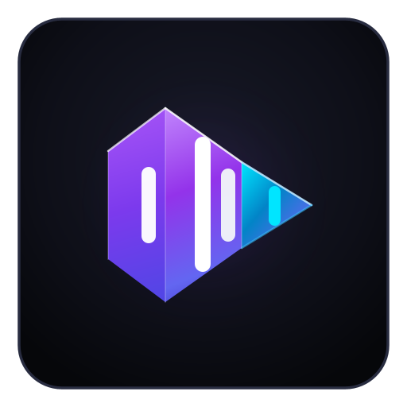

# OffGrid Music

### **Your Music. Your Way.**
**Listening to music offline just got a fresh upgrade.**

An offline-first, ad-free Android music player designed for listeners who want studio-grade sound, deep visual customization, synchronized lyrics, personal listening insights, and seamless control over their local music library—without subscriptions, clutter, or compromises.

 

---

## Download & Install

Get OffGrid Music directly on your Android phone (Android 7.0 and higher):

| Download Option | Link | What You Get |
| :--- | :--- | :--- |
| **Latest Release (Recommended)** | **[Download OffGrid-Music.apk](https://github.com/Paul00755/OffGrid-Music/releases/latest/download/OffGrid-Music.apk)** | Direct download of the newest version with all latest features and improvements. |
| **Direct Mirror Link** | **[Download from Latest Tag](https://github.com/Paul00755/OffGrid-Music/releases/download/latest/OffGrid-Music.apk)** | Alternative direct link to the newest release APK. |
| **All Versions & Release History** | **[Browse GitHub Releases](https://github.com/Paul00755/OffGrid-Music/releases)** | View release notes and download any current or previous version anytime. |

### Easy Updates & Hassle-Free Switching
- **Update Over Your Existing App:** Install any new APK right over your current OffGrid Music app—your playlists, favorites, synced lyrics, cover art, listening stats, and settings stay right where you left them.
- **Switch Versions Anytime:** Prefer an earlier release? Every version on the **[Releases Page](https://github.com/Paul00755/OffGrid-Music/releases)** can be installed over a newer build without uninstalling or losing your data.

---

## Why OffGrid Music?

Streaming apps decide what stays in your library, interrupt albums with ads, and hide your listening habits behind a once-a-year summary. Basic offline music players, on the other hand, often feel stuck in the past—missing smooth transitions, customizable design, synced lyrics, or modern queue control.

**OffGrid Music brings the best of both worlds together—on your device, on your terms:**
- **100% Yours, 100% Ad-Free:** Your songs live on your phone and play offline anytime—on flights, commutes, or anywhere off the grid.
- **Zero Forced Accounts:** Open the app, pick your music folders, and listen. Cloud backup, online lyrics search, AI lyric tools, and group listening sessions are completely optional.
- **Built for Both Comfort & Control:** Simple enough for everyday tap-and-play listening, yet packed with audio tuning, custom layouts, tag editing, and listening analytics when you want more.

---

## How OffGrid Differs from Other Offline Music Players

| Feature Area | Typical Offline Music Players | OffGrid Music |
| :--- | :--- | :--- |
| **Track Transitions** | Hard cuts or uneven volume drops between songs | **Gapless playback**, **0–12s equal-power Crossfade**, plus customizable **Fade-In & Fade-Out** |
| **Audio Consistency** | Quiet and loud tracks force constant volume adjustments | Built-in **Normalize Audio**, **Stereo Balance**, **5-Band EQ**, **Bass Boost**, and **3D Virtualizer** |
| **Lyrics Experience** | Plain static text or no lyrics support | **Live synced `.lrc` lyrics**, tap-to-seek, timing offset sync, online search, and optional **AI Translate / Transcribe** |
| **Per-Song Control** | Only Repeat Off / All / Infinite Repeat One | **"Repeat this song" (1–10×)** on the active track or queued songs, compatible with Crossfade, Gapless, and Sleep Timer |
| **Visual Personalization** | One fixed dark/light layout | **10 themes**, **4 display modes**, **Dynamic Artwork colors**, **Gradient & Frosted Glass**, **12 screen layouts**, and **5 widgets** |
| **Listening Insights** | Basic play counter at best | **Detailed Listening Stats**, **6-slide Wrapped Story**, **Calendar date/range picker**, and shareable stats cards |
| **Shared Listening** | Strictly solo listening | **OffGrid Jam** lets 2–10 friends listen in sync and share approved local songs directly device-to-device |
| **Library Hygiene** | Messy YouTube/site tags and ringtone clutter | **Folder include/exclude filters**, **short-clip filter**, **Duplicate Song Finder**, **ID3 Tag Editor**, and **One-Tap Tag Cleaner** |

---

## Features at a Glance

- **Studio-Grade Playback & Sound:** Gapless playback, 0–12s equal-power crossfade, play/pause fade ramps, loudness normalization, stereo L/R balance, 5-band Equalizer with 11 presets, Bass Boost, 3D Virtualizer, and a live Audio Output Switcher.
- **Smart Repeat, Gestures & Sonic Studio:** Repeat any song **1–10 times** (now playing or queued), swipe album art to skip, shake to skip, create **A–B Loops**, pin **Timestamp Bookmarks**, and launch **Sonic DNA Radio** mixes.
- **Synced Lyrics & Optional AI Studio:** Real-time scrolling `.lrc` lyrics with tap-to-seek, timing offset (`±ms`) saved locally, online lyric search, and optional Gemini AI translation/transcription (English, Tamil/Tanglish, Hindi, Malayalam) with one-tap Undo.
- **Precision Scanner & Library Tools:** Scans **12 audio formats** (`MP3`, `FLAC`, `M4A`, `AAC`, `OGG`, `OPUS`, `WAV`, `WMA`, `AMR`, `3GP`, `M4R`, `AIFF`) with native folder include/exclude rules, short-clip duration filter (`0–180s`), ID3 tag & cover art editor, Tag Cleaner, and Duplicate Finder.
- **Effortless Queue & Playlists:** 1:1 finger-tracked drag-and-drop queue & playlist sorting, duplicate-friendly queue with one-tap deduplication, custom playlist covers, M3U/M3U8 import & export, and rule-based Smart Playlists.
- **Unmatched Visual Customization:** 4 Display Modes, 10 curated themes, Dynamic Artwork colors, 10 accent presets + custom RGB picker, Gradient & Frosted Glass effects, 4 Home layouts, 4 Now Playing layouts (including Vinyl Turntable), 4 Playlist layouts, 4 waveform seekers, 90/120Hz smoothness, and **5 Home Screen Widgets** (including a live Lyrics Widget).
- **Listening Stats & Calendar Wrapped:** Track daily plays and listening habits across presets or any custom **Calendar date or date range**, explore **6-slide Wrapped Stories**, and share high-resolution stats cards.
- **OffGrid Jam, Storage & Optional Cloud Sync:** Listen together in synced 2–10 person rooms, manage local database capacity tiers or JSON backups, or optionally sync playlists, favorites, stats, lyrics offsets, and settings across devices via Google or Email sign-in.

---

## Every Feature in Detail

### 1. Audio Engine, Transitions & Sound Tuning
- **Gapless Playback:** Plays continuous albums, concerts, and mixes cleanly with zero silent gaps between tracks.
- **Equal-Power Crossfade (0–12 seconds):** Smoothly blends the end of one song into the start of the next without sudden volume dips in the middle.
- **Custom Play Fade-In & Pause Fade-Out (0–5,000 ms):** Gently ramps volume up when pressing play/resuming and smoothly fades out when pausing.
- **Normalize Audio:** Balances volume differences across tracks automatically so quiet songs and loud songs stay comfortable to listen to.
- **Stereo Channel Balance:** Fine-tune left and right speaker or headphone balance (`-1.0` Left to `+1.0` Right).
- **5-Band Graphic Equalizer + Effects:** Adjust `60 Hz`, `230 Hz`, `910 Hz`, `3.6 kHz`, and `14 kHz` frequencies, choose from **11 built-in presets** (*Flat/Normal, Bass Booster, Treble Booster, Vocal Booster, Rock, Pop, Jazz, Electronic, Classical, Hip-Hop, Acoustic*), and dial in **Bass Boost** and **3D Virtualizer** strength.
- **Live Audio Output Switcher:** Switch seamlessly between **Phone Speaker**, **Wired Headphones / Aux**, **Bluetooth Devices**, and **USB DACs** without leaving the player.
- **Smart Interruption & Volume Automation:**
  - **Duck Volume for Notifications:** Promptly lowers music volume when notifications arrive while avoiding double-ducking on phones with built-in system ducking.
  - **Auto-Pause for Camera & System Audio:** Automatically pauses music when the camera opens or another app plays audio, and resumes cleanly afterward.
  - **Pause on Zero Volume & Auto-Resume on Volume Increase:** Pauses automatically when media volume hits 0% and resumes when you turn the volume back up.
  - **Headphone & Startup Triggers:** Optional auto-play when wired or Bluetooth headphones connect, or when opening the app.

### 2. Now Playing Controls, "Repeat This Song" & Sonic Studio
- **Repeat This Song (1–10×):** Tap **Repeat this song** from either the **Now Playing menu** or any song inside the **Up Next Queue** to repeat that exact track up to **10 times**.
  - Works seamlessly alongside **Crossfade** and **Gapless Playback**—never cutting off early before repeats complete, then transitioning cleanly after the final repeat.
  - Resets automatically when you close and reopen the app so normal playback is always ready next time.
  - Automatically works with the track-based Sleep Timer (every repeat counts as 1 track).
- **Album Art Gestures & Shake to Skip:** Swipe horizontally on album art to go to the next or previous song, tap to play/pause, or physically shake your device to skip tracks.
- **Playback Queue Precision:** Insert songs at **Top Next** or **Bottom** of the queue, reorder with 1:1 finger-tracked drag-and-drop and smooth edge auto-scrolling, keep multiple occurrences of the same song, or remove duplicates with one tap.
- **Sonic Studio (A–B Loop, Bookmarks & DNA Radio):**
  - **A–B Loop:** Set custom start (`A`) and end (`B`) points to repeat a chorus, solo, or practice section automatically.
  - **Timestamp Bookmarks (Pins):** Save and jump directly to favorite timestamps with quick labels (*Intro, Beat Drop, Chorus, Guitar Solo, Bridge, Outro*, or custom names)—marked right on the seek waveform.
  - **Sonic DNA Radio:** Instantly builds a continuous 25-track radio queue matched to the vibe and sound profile of the currently playing song.

### 3. Synchronized Lyrics & Optional AI Lyric Studio
- **Live Synced `.lrc` Lyrics:** Smoothly highlights and auto-scrolls the current line with **tap-any-line-to-seek** and adjustable lyrics text size.
- **Per-Song Sync Offset (`±ms`):** Adjust lyric timing early or late down to milliseconds and save both the offset and updated `.lrc` file locally.
- **Multi-Source Lyrics Management:** Automatically checks local cache, companion `.lrc` files, and embedded audio tags—or lets you pick a local `.lrc` file, search online for multiple lyric candidates, and update/replace mismatched cached lyrics cleanly.
- **Optional Gemini AI Lyrics Studio (Off by Default):**
  - Connect your own Gemini API key (stored encrypted on your device and never included in cloud backups).
  - **Translate Existing Lyrics:** Translates lyrics line-by-line into **English, Tamil (including Tanglish), Hindi, or Malayalam** while preserving every `[mm:ss.xx]` timestamp.
  - **Transcribe Audio to Synced Lyrics:** Generates fresh timestamped `.lrc` lyrics directly from your song audio when no lyrics are found—complete with live preview, local `.lrc` export, and **one-tap Undo**.

### 4. Precision Library Scanning, Folder Control & Tag Tools
- **12 Supported Audio Formats:** `MP3`, `FLAC`, `M4A`, `AAC`, `OGG`, `OPUS`, `WAV`, `WMA`, `AMR`, `3GP`, `M4R`, and `AIFF`.
- **Smart Folder Filtering:** Use Android's native folder picker to explicitly **Include** or **Exclude** folders, browse music through the **Hierarchical Folder Browser**, or run a **Full-Device Scan** (with confirmation prompts so excluded folders aren't included by accident).
- **Short Audio Clip Filter (0–180s):** Filter out ringtones, voice notes, and notification tones with quick chips (*All Audio, 15s, 30s, 45s, 1m, 2m*) or a smooth slider up to 3 minutes.
- **Duplicate-Free Indexing & Live Auto-Refresh:** Recognizes storage aliases automatically so songs are never double-counted, and detects newly added songs in the background.
- **Flexible Browsing & Sorting:** Browse by **Songs, Albums, Artists, and Folders**, jump through large collections with a **Fast Scrollbar**, search instantly (with one-tap search history clearing), and sort by **Title, Artist, Album, Recently Added, Recently Played, or Duration**.
- **On-Device ID3 Tag & Cover Art Editor:** Edit **Title, Artist, Album, Genre, Year, Track Number, Embedded Cover Artwork, and Lyrics** directly inside your audio files.
- **Automatic Tag Cleaner & Duplicate Song Finder:** Clean messy `[Official Video]`, `(Lyrics)`, website watermarks, and track-number prefixes in one tap, and inspect/clean duplicate tracks across your library.

### 5. Playlists & Smart Collections
- **Custom Playlists:** Create playlists with custom cover photos (preserved safely during cloud sync), set whether newly added songs go to the **Top** or **Bottom**, drag-and-drop reorder tracks, remove duplicates, and import/export standard **`.m3u` / `.m3u8`** playlist files.
- **Rule-Based Smart Playlists:** Build auto-updating playlists using filters for **Artist, Genre, Release Year Range, Minimum Play Count, Favorites Only, and Recently Added (Days)** with custom sorting and track limits (`25`, `50`, `100`, `200`, or `500`).
- **Favorites & Recently Played:** Dedicated quick-access views and shortcuts in both the Home feed and navigation side drawer.

### 6. Themes, Screen Layouts, Waveforms & Home Screen Widgets
- **4 Display Modes:** *Dark, Light, Pure AMOLED Black, and Follow System*.
- **10 Curated Themes:**
  - *Dark & AMOLED:* **Midnight Obsidian, Pure AMOLED, Cyberpunk Synth, Nordic Frost, Emerald Forest, Sunset Amber, Crimson Velvet, Royal Amethyst**.
  - *Light:* **Porcelain Slate, Warm Parchment**.
- **Colors & Atmospheric Visuals:**
  - **Dynamic Artwork Theming:** Automatically adapts backgrounds and accents to the current album cover.
  - **10 Accent Presets + Custom RGB Color Picker** for exact custom shades.
  - **App-Wide Gradient & Frosted Glass Effects:** Independent toggles for ambient color washes and translucent frosted cards/sheets across every screen.
  - **Display Scale & Smoothness:** Choose **Compact, Standard, or Comfort** UI sizing, toggle **90/120Hz High Refresh Rate**, and choose **Prefer High-Res Online Artwork** or fast local covers.
- **12 Switchable Screen Layouts:**
  - **4 Home Layouts:** *Hero Spotlight, Bento Mosaic, Minimal Stream, Studio Deck* — plus **9 Toggleable & Reorderable Home Feed Sections** (*Continue Listening, Speed Dial, Listening Stats, Most Played, Most Played Playlists, Recently Played, Recently Added, Top Artists, Top Albums*).
  - **4 Now Playing Layouts:** *Modern Bento, Vinyl Turntable (animated spinning record & tonearm), Minimalist Glass, Neon Studio*.
  - **4 Playlists Layouts:** *Bento Grid, Magazine Hero, Compact List, Neon Deck*.
- **Seek Waveform & Mini Player Customization:** Choose from **4 Waveform Styles** (*Sleek Line, Snake Sine, Symmetric, Dotted*) and **2 Mini Player Styles** (*Floating Pill* or *Bottom Bar*) with toggles for Previous, Next, and Favorite buttons.
- **5 Native Android Home Screen Widgets:** **Full Artwork Widget, Small Widget, Medium Widget, Secondary Widget, and Live Lyrics Widget** (displaying synced lyrics and seek/playback controls right on your launcher).

### 7. Listening Statistics, Calendar Wrapped Story & Sleep Timer
- **Customizable Track Completion Rules:** Decide when a listen counts as a play—by **Seconds** (`5–180s`) or **Percentage** (`10–100%`).
- **Real-Time Listening Analytics:** View total listening time, 7-day daily charts, Top Tracks, Top Artists, Top Albums, and Time-of-Day listener profiles across **Today, Yesterday, Last 7 Days, This Month, and All Time**.
- **6-Slide Interactive Wrapped Story + Calendar Picker:**
  - Launch an animated 6-slide Wrapped Story at any time of the year.
  - Pick presets (*Today, Yesterday, This Week, Last 7 Days, This Month, Last Month, This Year, All Time*) or **choose any single date or custom date range from the Calendar**.
  - Export and share high-resolution stats cards as images in one tap.
- **Dual-Mode Sleep Timer:**
  - **Time-Based:** Quick presets (`15m`, `30m`, `45m`, `60m`) or custom (`1–720m`), live `+5m / +15m / +30m` extend buttons, and *"Finish playing current track completely before stopping"*.
  - **Track-Based:** Quick presets (`1, 2, 5, 10 tracks`) or custom (`1–100 tracks`)—counting every repeated play cleanly and stopping right at `0:00` of the next track.

### 8. OffGrid Jam (Listen Together), Storage & Optional Cloud Sync
- **OffGrid Jam (2–10 Listeners):**
  - Host or join live group listening rooms via **Invite Code, Invite Link, or QR Code Scanner** so everyone stays synced in real time.
  - Share approved local songs (up to 25 MB) directly from device to device with participants in the room without uploading your music files to cloud storage.
- **Local Storage & Cache Control:**
  - Monitor and clear lyrics, album art, and song art caches independently or all at once.
  - Pick from **3 Local Database Capacity Tiers** (*Standard 10K, Expanded 50K, Maximum 100K* history records) with one-tap **Optimize DB**.
- **Optional Cloud Backup & Cross-Device Sync:**
  - Sign in with **Google** or **Email/Password** (or stay 100% local without an account).
  - Back up and restore **Favorites, Playlists, Smart Playlists, Listening Stats, Synced Lyrics, Offset Values, Folder Rules, and App Preferences**—with **Backup Now** (uploads current local state cleanly), **Sync Now** (restores latest cloud snapshot while protecting your custom local playlist cover images), and scheduled **Automatic Backups** (*Daily, Weekly, or Monthly*).
- **Updates, Diagnostics & Safe Reset:** Built-in GitHub release checker & optional update alerts, `.TXT` / `.JSON` diagnostics log export, Keep Screen Awake option, and **Reset to Default Settings** that keeps your songs, playlists, favorites, history, and API keys untouched.

---

<strong>Keywords & Related Topics (for Search)</strong>

`OffGrid Music` · `Offline Music Player` · `Android Offline Music Player` · `Local Music Player Android` · `MP3 FLAC Audio Player` · `Gapless Crossfade Music Player` · `Synced LRC Lyrics Player` · `5 Band Equalizer Bass Boost` · `MP3 ID3 Tag Editor Android` · `Ad-Free Music Player APK` · `Listening Stats & Wrapped Story` · `Music Player with Home Screen Widgets` · `Listen Together OffGrid Jam` · `Your Music Your Way`

---

**OffGrid Music — Your Music. Your Way.**

[Download Latest APK](https://github.com/Paul00755/OffGrid-Music/releases/latest/download/OffGrid-Music.apk) · [All Releases](https://github.com/Paul00755/OffGrid-Music/releases)

