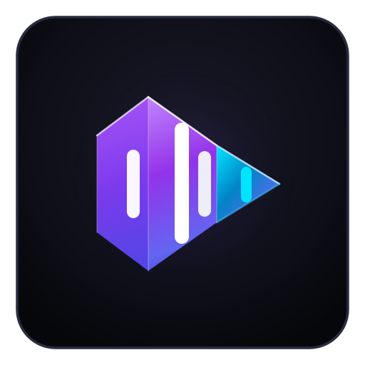

# 🎵 OffGrid Music

<p align="center">
  
</p>

<p align="center">
  <strong>An audiophile offline-first Android music player featuring smart audio controls, synchronized lyrics, and dynamic visual design.</strong>
</p>

<p align="center">
  <a href="../../releases/latest/download/app-debug.apk">
    
  </a>
  <a href="../../releases">
    
  </a>
  <a href="../../actions/workflows/build-apk.yml">
    
  </a>
  
  
</p>

---

## 📥 How to Download the Latest APK

Every push to this GitHub repository triggers an automated GitHub Actions CI/CD workflow that compiles and builds the freshest APK.

### Direct Download from GitHub Releases 
1. Click the button above or visit 👉 [**Latest Release Downloads**](../../releases/latest)
2. Under **Assets**, click **`app-debug.apk`** to download it directly to your device.
3. Direct link: [**`app-debug.apk`**](../../releases/latest/download/app-debug.apk) *(Available after the GitHub Action run finishes)*.


> 💡 **Android Installation Note:** When installing for the first time, your Android browser or file manager may ask permission to *"Install unknown apps"*. Toggle this to allow installation.

---


## ✨ Unique & Highlighted Features

### 🎧 1. Studio-Grade Audio Transitions & Engine
* **Equal-Power Audio Crossfade**: Smooth sinusoidal overlap curve ($\sin/\cos$) between Song A and Song B. Preserves perceived acoustic loudness without volume dips, stutter, or overplay.
* **True Gapless Playback**: Native ExoPlayer buffer concatenation eliminates dead silence between continuous live or conceptual tracks.
* **Intelligent Non-Gapless Boundary**: For standard tracks when gapless is turned off, inserts a clean, pop-free 250ms inter-track pause starting precisely at `0:00`.
* **Perceptual Audio Normalizer (ReplayGain)**: ITU-R BS.1770 K-weighting detection sidechain with soft-knee limiter and sample-by-sample linear gain interpolation. Eliminates jarring volume jumps between quiet acoustic and loud mastered tracks.
* **Audio Routing Optimization**: Seamless output across wired headphones, Bluetooth earbuds, and internal phone speakers, with automatic playback pause on headphone disconnect (`BecomingNoisy`).
* **5-Band Equalizer & Sound FX**: Parametric EQ bands, virtualizer, bass boost, and pitch/tempo controls.

---

### 🎤 2. Synced Lyrics & Real-Time Adaptation
* **Real-time Synced LRC Display**: Syllable and line-synchronized scrolling lyrics that stay lockstep with the music.
* **Theme-Adaptive Visuals**: High-contrast active line highlights that intelligently adapt between Light Mode (tinted container with high contrast border) and Dark/AMOLED Mode.
* **Built-in Lyrics Manager**: Search and edit lyrics, or transcribe and translate tracks with on-device speech processing.

---

### 📂 3. Smart Offline Library Management
* **Instant Favorite Toggle**: Zero-flicker favorite status updating. Toggling a favorite updates the track immediately without reordering the list or temporarily jumping to alphabetical view.
* **Multi-Category Navigation**: Organize and browse by **Songs**, **Albums**, **Artists**, and storage **Folders**.
* **Flexible Sorting**: Sort instantly by Recently Added, Recently Played, Title, Artist, Album, or Duration.
* **Duplicate Finder & Cleaner**: Fast scan engine detects and manages duplicate audio tracks across your local device.
* **ID3 Tag & Cover Art Editor**: Edit embedded track titles, artists, albums, and customize high-resolution cover art with real-time notification updating.

---

### 🧭 4. Ergonomic Navigation & UI Design
* **Previous Tab Navigation**: Dedicated back button ($\leftarrow$) at the top-left corner of the **Favorites Screen** (and system back gesture) returns you directly to whatever tab you came from (Home, Library, Search, etc.).
* **Bento Grid & Material You**: Beautiful dynamic accent colors extracted from current album art, customizable accent presets, and pure black AMOLED mode.
* **Glance App Widgets**: 3 customizable home screen widgets (Player Card, Wide Player, and Compact Pill) with live progress tracking.

---

### ⏱️ 5. Sleep Timer & Analytics
* **Flexible Sleep Timer**: Set a timer by minutes or song count, with a "Finish Last Song" toggle to avoid cutting off your favorite track mid-chorus.
* **Listening Stats & Wrapped**: Detailed daily listening statistics, peak listening hours, favorite genres, top tracks, and personal music wrapped summaries.

---

## 🛠️ Tech Stack & Architecture

* **UI Framework:** 100% Jetpack Compose with Material 3 (M3)
* **Audio Playback:** AndroidX Media3 ExoPlayer with foreground `MediaSessionService`
* **Local Persistence:** Room Database with Kotlin Coroutines Flow
* **Architecture:** MVVM (Model-View-ViewModel) + Repository Pattern
* **Concurrency:** Kotlin Coroutines & StateFlow
* **Widgets:** Jetpack Glance AppWidget

---

## 🏗️ Building from Source Locally

To build the APK locally on your machine:

1. Clone this repository:
   ```bash
   git clone https://github.com/<your-username>/<your-repo-name>.git
   cd <your-repo-name>
   ```

2. Build the debug APK with Gradle:
   ```bash
   ./gradlew assembleDebug
   ```

3. The generated APK will be available at:
   ```
   app/build/outputs/apk/debug/app-debug.apk
   ```

4. Install directly to a connected Android device:
   ```bash
   adb install -r app/build/outputs/apk/debug/app-debug.apk
   ```

---

