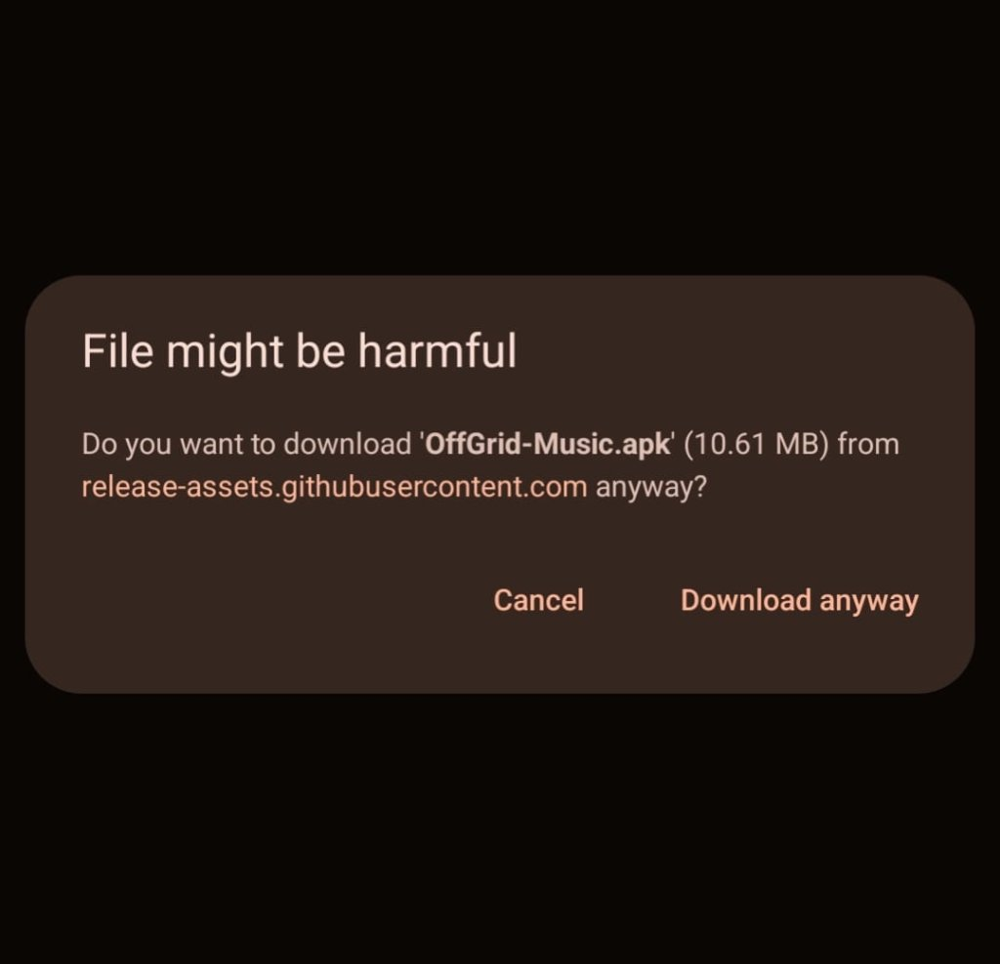
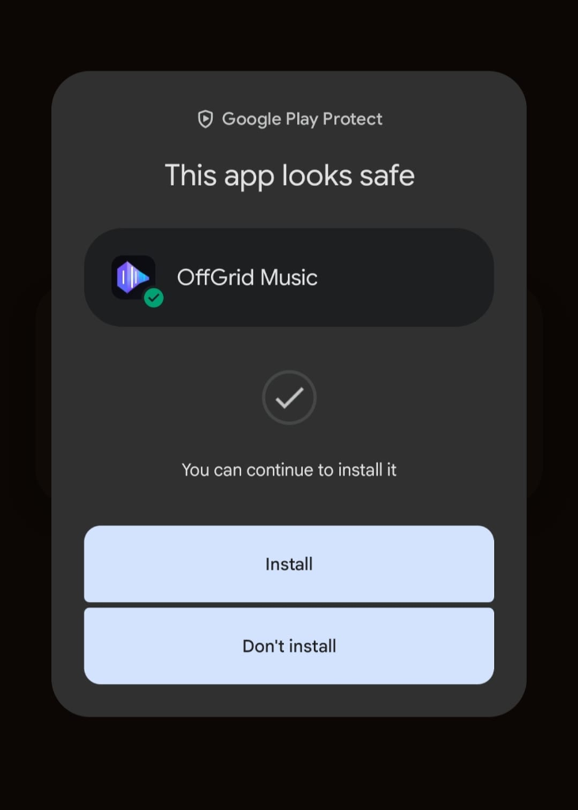

# OffGrid Music

### **Your Music. Your Way.**
**An offline-first, 100% ad-free Android music player with real-time synced `.lrc` lyrics, live home screen lyrics widgets, 15 customizable UI layouts, 5-band EQ, Google Cast & DLNA TV lyrics streaming, and optional encrypted cloud backup.**

  
  
  
  

  
  
  
  
  

**[Explore Interactive Showcase Website](https://offgrid-music-web.pages.dev/)** · **[Download Latest APK](https://github.com/Paul00755/OffGrid-Music/releases/latest/download/OffGrid-Music.apk)** · **[Watch Live Lyrics Widget Demos](https://offgrid-music-web.pages.dev/#live-lyrics)** · **[Support via Buy Me a Coffee](https://buymeacoffee.com/paulrajmes9)**

 

<table>
  <tr>
    <td align="center" width="33%">
       
      <strong>Now Playing · Vinyl Turntable</strong>
    </td>
    <td align="center" width="33%">
       
      <strong>Now Playing · Modern Bento</strong>
    </td>
    <td align="center" width="33%">
       
      <strong>Home · Hero Spotlight</strong>
    </td>
  </tr>
</table>

---

## Official Website & Support Links

- **Interactive Showcase Website:** **[offgrid-music-web.pages.dev](https://offgrid-music-web.pages.dev/)** — Preview all 15 UI layouts interactively, watch Live Lyrics Widget video captures in English and Tamil, explore the categorized FAQ, and grab the latest release APK.
- **Support Independent Development:** **[buymeacoffee.com/paulrajmes9](https://buymeacoffee.com/paulrajmes9)** — OffGrid Music is built and maintained by an independent student developer with zero ads, zero paywalls, and zero tracking. If OffGrid Music upgrades your daily offline listening, buying a coffee directly helps fund new features and releases.

---

## Download & Install (Android 7.0+)

| Option | Link | Details |
| :--- | :--- | :--- |
| **Interactive Showcase & Download Hub** | **[offgrid-music-web.pages.dev](https://offgrid-music-web.pages.dev/)** | Full feature walkthrough, interactive UI Layout Studio preview, live widget videos, and latest APK download. |
| **Latest APK (Direct Download)** | **[Download OffGrid-Music.apk](https://github.com/Paul00755/OffGrid-Music/releases/latest/download/OffGrid-Music.apk)** | Direct download of the newest signed release APK with all latest features and fixes. |
| **Direct Mirror (Latest Tag)** | **[Download from Latest Tag](https://github.com/Paul00755/OffGrid-Music/releases/download/latest/OffGrid-Music.apk)** | Alternative canonical mirror link to the newest release APK. |
| **All Releases & Changelog History** | **[Browse GitHub Releases](https://github.com/Paul00755/OffGrid-Music/releases)** | View plain-language release notes and install any current or previous version. |
| **Support the Developer** | **[Buy Me a Coffee](https://buymeacoffee.com/paulrajmes9)** | Optional support for ongoing independent open-source development. |

### Update Over Your Existing App Without Losing Data
- **New Install Help:** First time installing an Android `.apk`? Jump to **[Frequently Asked Questions (#1 Download Steps & #2 Play Protect Scan)](#-frequently-asked-questions)**.
- **In-Place Upgrades:** Install any newer `OffGrid-Music.apk` directly over your current installation without uninstalling. Your playlists, favorites, synced `.lrc` lyrics, timing offsets, cover art, listening stats, and custom layouts stay intact.
- **Built-In OTA Checker & Aggregated Changelogs:** Automatic semantic releases (`v1.0.5`, `v1.0.15`, ...) come with an in-app GitHub release checker that summarizes every improvement since your installed version in one view.

---

## Why Listeners Choose OffGrid Music Over Streaming & Basic Offline Players

Streaming platforms decide which songs disappear from your library, interrupt albums with ads, and lock your listening insights behind a yearly recap. Meanwhile, basic local Android audio players often feel frozen in time—lacking smooth crossfade transitions, real-time synchronized lyrics, home screen widgets, TV casting, or reliable backup when you switch phones.

**OffGrid Music delivers flagship design and audiophile control—100% offline, open source, and ad-free:**
- **Zero Internet Required for Music:** Plays 12 local audio formats directly from device storage—built for flights, road trips, underground commutes, and off-grid listening.
- **Optional Encrypted Cloud Sync & Backup:** Sign in with **Google** or **Email & Password** to sync favorites, playlists, smart playlists, stats, lyrics timing offsets, folder rules, and layout preferences across phones—or skip login completely and stay 100% local.
- **TV Casting with Live Synced Lyrics:** Stream offline songs, artwork, and live synchronized lyrics straight to **Chromecast, Google TV, Android TV, and DLNA Smart TVs** over local Wi-Fi—no cloud uploads needed.

---

## 15 Screens. One Player. — Live Screen Layout Studio

OffGrid Music lets you mix and match **4 Now Playing**, **4 Home Screens**, **3 Synced Lyrics UIs**, and **4 Playlists Views** inside the **Live Screen Layout Studio**—complete with live previews using your currently playing track, album cover, and synced lyrics, plus **Combo View** before you apply.

> Try the interactive layout switcher live on the **[Official Website UI Studio](https://offgrid-music-web.pages.dev/#ui-studio)**.

<table>
  <tr>
    <td align="center" width="33%">
       
      <strong>Screen Layout Studio (Combo View)</strong>
    </td>
    <td align="center" width="33%">
       
      <strong>AMOLED, RGB Wheel &amp; Glass Effects</strong>
    </td>
    <td align="center" width="33%">
       
      <strong>Home Feed &amp; Bottom Bar Order</strong>
    </td>
  </tr>
</table>

<strong>Explore All 15 UI Layouts Gallery (Now Playing · Home · Lyrics · Playlists)</strong>

#### 1. Now Playing Layouts (4 Styles)
| Modern Bento | Vinyl Turntable | Minimalist Glass | Neon Studio |
| :---: | :---: | :---: | :---: |
|  |  |  |  |
| Full-bleed edge-to-edge cover art dissolving into a color-matched control deck with **Wave** default seekbar. | Spinning 33⅓ RPM vinyl platter, animated S-shaped tonearm, center label art &amp; live output badge. | Framed square cover art on an ultra-clean AMOLED canvas with frosted pill transport controls. | Full-screen dynamic dual-tone artwork gradient with crisp white controls &amp; floating utility pill. |

#### 2. Home Screen Layouts (4 Styles)
| Hero Spotlight | Studio Deck | Minimal Stream | Bento Mosaic |
| :---: | :---: | :---: | :---: |
|  |  |  |  |
| Personalized greeting, active track waveform card, catalog shuffle &amp; 10-song **New Music Mix**. | Pro-audio ON AIR deck status, 4-tile Launch Matrix &amp; Audio Telemetry stats bar. | Streamlined editorial feed with compact streaming bar, quick chips &amp; circular recents. | Modular bento cards for Continue Listening, large Pause button &amp; multi-period stats. |

#### 3. Synced Lyrics UI Layouts (3 Styles) &nbsp;·&nbsp; 4. Playlists Layouts (4 Styles)
<table>
  <tr>
    <td align="center" width="33%">
       
      <strong>Lyrics · Studio Timeline</strong>
    </td>
    <td align="center" width="33%">
       
      <strong>Lyrics · Classic Bento</strong>
    </td>
    <td align="center" width="33%">
       
      <strong>Lyrics · Fluid Glow</strong>
    </td>
  </tr>
</table>

<table>
  <tr>
    <td align="center" width="25%">
       
      <strong>Playlists · Bento Grid</strong>
    </td>
    <td align="center" width="25%">
       
      <strong>Playlists · Magazine Hero</strong>
    </td>
    <td align="center" width="25%">
       
      <strong>Playlists · Compact List</strong>
    </td>
    <td align="center" width="25%">
       
      <strong>Playlists · Neon Deck</strong>
    </td>
  </tr>
</table>

---

## Real-Time Synced Lyrics & Live Home Screen Lyrics Widgets

OffGrid Music is built as a true **synced lyrics music player for Android**, supporting embedded lyric tags, local `.lrc` files, one-tap online lyric lookup, millisecond offset adjustment (`±ms`), optional Gemini AI translation/transcription, and **real-time scrolling Home Screen Lyrics Widgets**—even in regional scripts like Tamil, Hindi, and Malayalam.

<table>
  <tr>
    <td align="center" width="33%">
       
      <strong>Live Lyrics Widget (Tamil &amp; Multi-Script)</strong> 
      <a href="https://offgrid-music-web.pages.dev/assets/videos/lyric-widget-tamil.mp4">▶ Watch Tamil Widget Capture (.mp4)</a>
    </td>
    <td align="center" width="33%">
       
      <strong>5 Adaptive Launcher Widgets</strong> 
      <a href="https://offgrid-music-web.pages.dev/assets/videos/lyric-widget-english.mp4">▶ Watch English Lyrics Widget (.mp4)</a>
    </td>
    <td align="center" width="33%">
       
      <strong>Find Synced Lyrics Online + .LRC</strong> 
      <a href="https://offgrid-music-web.pages.dev/#live-lyrics">🌐 View Live Video Demos on Website</a>
    </td>
  </tr>
</table>

- **5 Adaptive Android Home Screen Widgets:** **Live Lyrics Widget**, **Full Artwork Widget**, **Small Widget**, **Medium Widget**, and **Secondary Widget**—all extracting dynamic artwork colors and featuring real-time seekbars, favorite toggles, and playback controls.
- **Tap-to-Seek & Precision Sync (`±ms`):** Tap any lyric line inside **Studio Timeline**, **Classic Bento**, or **Fluid Glow** to jump immediately, or shift timing early/late and save directly to local storage.
- **Optional Gemini AI Lyrics Studio (Off by Default):** Add your own Gemini API key (stored encrypted on-device and never uploaded to cloud backups) to translate synced lyrics line-by-line (**English, Tamil/Tanglish, Hindi, Malayalam**) or transcribe audio into timestamped `.lrc` lyrics with one-tap Undo.

---

## Studio Audio Engine, Sonic Studio, Insights & Casting

<table>
  <tr>
    <td align="center" width="33%">
       
      <strong>Audio &amp; Sound Engine</strong>
    </td>
    <td align="center" width="33%">
       
      <strong>Sonic Studio &amp; Repeat 1–10×</strong>
    </td>
    <td align="center" width="33%">
       
      <strong>7 Waveform &amp; Seekbar Styles</strong>
    </td>
  </tr>
  <tr>
    <td align="center" width="33%">
       
      <strong>Listening Streaks &amp; Pace</strong>
    </td>
    <td align="center" width="33%">
       
      <strong>6-Slide Calendar Wrapped</strong>
    </td>
    <td align="center" width="33%">
       
      <strong>Optional Encrypted Cloud Backup</strong>
    </td>
  </tr>
</table>

---

## How OffGrid Differs from Typical Offline Music Players

| Feature Area | Typical Offline Music Players | OffGrid Music |
| :--- | :--- | :--- |
| **Track Transitions** | Hard cuts or uneven volume drops between songs | **Gapless playback**, **0–12s equal-power Crossfade**, plus customizable **Play Fade-In & Pause Fade-Out (0–5,000 ms)** |
| **Audio Tuning** | Quiet and loud tracks force manual volume changes | **Normalize Audio**, **Stereo L/R Balance**, **5-Band Graphic EQ (11 presets)**, **Bass Boost**, **3D Surround**, and **Live Output Switcher** |
| **Lyrics Experience** | Plain static text or no lyrics support | **Live synced `.lrc` lyrics** across **3 Lyrics UIs**, **Live Lyrics Home Screen Widget**, tap-to-seek, `±ms` offset, online search &amp; optional **AI Translate / Transcribe** |
| **TV & Speaker Casting** | Phone-only local playback | Built-in **Google Cast** &amp; **DLNA Smart TV** casting over local Wi-Fi with **Live TV Synced Lyrics (HLS video streaming)** and hardware volume key control |
| **Per-Song & Practice Tools** | Only Repeat Off / All / Infinite One | **Repeat This Song (1–10×)** on active or queued tracks, **A–B Loop**, **Timestamp Pins**, **Sonic DNA Radio**, and **5 / 10 / 15 / 30s seek buttons** |
| **Visual Personalization** | One fixed dark or light layout | **15 UI layouts**, **4 Display Modes (incl. Pure AMOLED)**, **RGB Color Wheel**, **Dynamic Artwork colors**, **Artwork Glass** default mini-player (4 styles), **Classic 8** default Home Feed order + **Bottom Bar reordering**, **7 Waveforms**, and **5 Adaptive Widgets** |
| **Cloud Backup & Restore** | Lose playlists and stats when changing phones | Optional **Google & Email/Password** encrypted cloud snapshots (**Backup Now**, **Sync / Restore Now**, Daily/Weekly/Monthly **Automatic Backups**) — or 100% local |
| **Listening Insights** | Basic play counter at best | **Listening Streaks**, **Pace Analytics**, **6-Slide Calendar Wrapped Story**, Listener Archetypes, and one-tap shareable stats cards |
| **Shared Listening** | Strictly solo listening | **OffGrid Jam** lets **2–10 friends** listen in real-time sync via Invite Code, Link, or QR Scanner and share local songs (up to 25 MB) peer-to-peer |
| **Library Hygiene** | Messy site tags and ringtone clutter | **12 audio formats**, native **Folder Include/Exclude**, **short-clip filter (0–180s)**, **Duplicate Finder**, **ID3 Tag Editor**, and one-tap **Tag Cleaner** |

---

## Complete Feature Breakdown

### 1. Audio Engine, Transitions & Sound Tuning
- **Gapless Playback & Equal-Power Crossfade (`0–12s`):** Plays continuous live albums and mixes with zero silent gaps or smooth equal-power transitions.
- **Play Fade-In & Pause Fade-Out (`0–5,000 ms`):** Gently ramps volume on play/resume and fades smoothly on pause.
- **5-Band Graphic Equalizer + Effects:** Tune `60 Hz`, `230 Hz`, `910 Hz`, `3.6 kHz`, and `14 kHz` with **11 presets** (*Flat/Normal, Bass Booster, Treble Booster, Vocal Booster, Rock, Pop, Jazz, Electronic, Classical, Hip-Hop, Acoustic*), **Bass Boost**, **3D Surround / Virtualizer**, **Normalize Audio**, and **Stereo Channel Balance (`-1.0` to `+1.0`)**.
- **Live Audio Output Switcher & Smart Volume Automation:** Switch between **Phone Speaker**, **Wired Headphones / Aux**, **Bluetooth Devices**, and **USB DACs**; duck volume for notifications without double-ducking; auto-pause on camera or system audio; pause on 0% volume and auto-resume when volume rises; optional auto-play on headphone connection or startup.

### 2. Google Cast, DLNA Smart TV & TV Synced Lyrics
- **Cast Offline Music Over Local Wi-Fi:** Stream local songs and album art directly to **Chromecast, Google TV, Android TV, Nest Speakers**, and **DLNA / UPnP Smart TVs** (Samsung, LG, Sony, Roku, Sonos, Xbox, Kodi) via an on-device token-protected LAN HTTP server (`LocalCastMediaServer`)—zero cloud upload required.
- **Live Synced TV Lyrics (`CastHlsStreamer`):** On Chromecast / Google TV, renders crisp real-time synchronized lyrics directly beneath track title and artist in an on-demand local HLS stream (supporting English, Tamil, Hindi, Telugu, and more) while keeping TV Ambient Mode / Screensaver from interrupting playback.
- **Seamless Hardware & Widget Control:** Control TV playback and volume using your phone's physical hardware volume keys, Now Playing, home screen widgets, notifications, or connected headphones.

### 3. Now Playing, "Repeat This Song", Sonic Studio & Waveform Behavior
- **Smart Waveform Defaults:** **Modern Bento** defaults to **Wave**, while **Vinyl Turntable**, **Minimalist Glass**, and **Neon Studio** default to **Snake Sine**—and once you pick your preferred style from all **7 Waveform & Seekbar Styles** (*Sleek Line, Snake Sine, Symmetric, Dotted, Squiggly, Wave, Bar*), your choice stays preserved across every Now Playing screen.
- **Repeat This Song (`1–10×`):** Repeat the active track or any queued song up to 10 times cleanly alongside Crossfade, Gapless Playback, and Track-Based Sleep Timer.
- **Sonic Studio:** Create **A–B Loops**, save **Timestamp Bookmarks (Pins)** (*Intro, Beat Drop, Chorus, Guitar Solo, Bridge, Outro*, or custom labels) directly on the seek waveform, and generate a 25-track **Sonic DNA Radio** queue.
- **Smart Queue & Controls:** Optional **Smart Shuffle**, adjustable **`5 / 10 / 15 / 30s`** seek buttons, swipe album art to skip, shake to skip, and 1:1 finger-tracked drag-and-drop queue reordering.

### 4. Synchronized Lyrics, Live Widgets & Optional Gemini AI Studio
- **Multi-Source Synced `.lrc` Engine:** Loads local cache, companion `.lrc` files, and embedded audio tags, or searches online for multiple synced lyric matches with per-song `±ms` timing offset saved locally.
- **3 Dedicated Lyrics UIs + 5 Adaptive Widgets:** Switch between **Studio Timeline**, **Classic Bento**, and **Fluid Glow**, and pin the **Live Lyrics Widget** (plus Full Artwork, Small, Medium, and Secondary widgets) to your Android launcher.
- **Optional Gemini AI Lyrics Studio (Off by Default):** Bring your own encrypted on-device Gemini API key to translate synced lyrics into **English, Tamil/Tanglish, Hindi, or Malayalam** or transcribe audio into timestamped `.lrc` lyrics with live preview and one-tap Undo.

### 5. Library Scanner, Playlists, Home Feed & Customization
- **12 Supported Audio Formats:** `MP3`, `FLAC`, `M4A`, `AAC`, `OGG`, `OPUS`, `WAV`, `WMA`, `AMR`, `3GP`, `M4R`, and `AIFF`.
- **Precision Scanner & Hygiene:** Native folder include/exclude picker, hierarchical Folder Browser, Short Audio Clip Filter (`0–180s`), duplicate-free indexing, on-device **ID3 Tag & Cover Art Editor**, **Tag Cleaner**, and **Duplicate Song Finder**.
- **Playlists & Smart Playlists:** Custom playlist covers, M3U/M3U8 import & export, drag-and-drop track sorting, and auto-updating **Smart Playlists** (filter by Artist, Genre, Year Range, Min Play Count, Favorites, and Recently Added).
- **Theme Engine, Classic 8 Feed & Artwork Glass Mini-Player:**
  - **4 Display Modes:** *Dark, Light, Pure AMOLED Black, Follow System*.
  - **Accent Palette + RGB Color Wheel + Hex Picker**, **Dynamic Artwork Theming**, **Use Dark Colors / Palette Lite** toggle, **Gradient Effect**, **Frosted Glass Effect**, and **90/120Hz High Refresh Rate** smoothness.
  - **Organize & Order Your Feed:** Starts with the clean **Classic 8** Home Feed order (*Continue Listening, Quick Actions, Suggestions New Music Mix, Listening Stats, Recently Played, Most Played Playlists, Most Played, Top Artists*), lets you show/hide/reorder all 10 sections, save **Custom Named Feed Presets**, and rearrange all 5 **Bottom Navigation Bar** tabs.
  - **4 Mini-Player Styles:** Defaults to **Artwork Glass** (*Floating Pill, Bottom Bar, Artwork Glass, Compact Slim*) with swipe-to-skip, swipe-up to open, optional swipe-down to dismiss, and toggleable buttons.

### 6. Listening Insights, 6-Slide Wrapped, Sleep Timer, Cloud Backup & OffGrid Jam
- **Real-Time Analytics & Calendar Wrapped:** Track active listening streaks, daily listening pace, custom play-completion rules (`5–180s` or `10–100%`), launch a **6-Slide Wrapped Story** for any preset or custom Calendar date/range, discover your Listener Archetype, and share high-resolution stats cards.
- **Dual-Mode Sleep Timer:** **Time-Based** (up to 180 min + live `+5/+10/+15m` extensions & *"Finish current track"*) or **Track-Based** (up to 50 tracks + `+1/+2` track extensions).
- **Optional Encrypted Cloud Backup (`Google` / `Email & Password`):** Trigger **Backup Now**, **Sync / Restore Now**, or scheduled **Automatic Backups** (*Daily, Weekly, Monthly*)—never uploading your MP3/FLAC files or Gemini API key.
- **OffGrid Jam (2–10 Listeners):** Host or join synchronized listening rooms via **Invite Code, Invite Link, or QR Code Scanner**, vote on shared-library recommendations, and transfer approved local tracks (up to 25 MB) directly peer-to-peer via WebRTC without cloud audio storage.
- **Storage, FAQ & Support:** 3 SQLite capacity tiers (*10K, 50K, 100K* history records), one-tap **Optimize DB**, searchable 16-question in-app **FAQ** (with APK install & Play Protect guide), `.TXT` / `.JSON` diagnostics export, and direct support at **`offgridmusicsupport@gmail.com`**.

---

## Frequently Asked Questions

### 1. How do I download and install the OffGrid Music APK?
Follow these quick steps on Android 7.0+:

1. **Download the APK:** Tap **[Download OffGrid-Music.apk](https://github.com/Paul00755/OffGrid-Music/releases/latest/download/OffGrid-Music.apk)** or open **[offgrid-music-web.pages.dev](https://offgrid-music-web.pages.dev/)** in your phone's browser.
2. **Allow Browser Download Access (if asked):** Grant storage/download permission if your browser requests it, then tap **Download anyway** if Android shows *"File might be harmful"* (shown automatically for every `.apk` download outside the Play Store).
3. **Allow "Install unknown apps" (one-time per browser or file manager):**
   - Tap **Open** on the download notification (or open your **Files / Downloads** app and tap `OffGrid-Music.apk`).
   - When Android displays *"For your security, your phone currently isn't allowed to install unknown apps from this source"*, tap **Settings** right on that popup.
   - Or open **Android Settings → Apps → Special app access → Install unknown apps**, choose your browser (**Chrome, Brave, Samsung Internet, etc.**) or **Files**, and turn **ON** **Allow from this source**.
4. **Verify & Install:** Press Back, allow **Google Play Protect** to scan the package (*"This app looks safe"*), tap **Install**, and open **OffGrid Music**.
5. **Future Updates:** You never need to uninstall first—installing any newer `OffGrid-Music.apk` (via browser or the built-in in-app updater) keeps all playlists, synced `.lrc` lyrics, listening stats, and settings intact.

---

### 2. My browser shows *"File might be harmful"* when downloading `OffGrid-Music.apk` — is it really safe?
**Yes—100% safe.** Android browsers automatically display a generic *"File might be harmful"* popup for **every `.apk` file** downloaded outside the Google Play Store simply because the file ends in `.apk`, **not** because anything unsafe was found.

- Once you tap **Download anyway** from `release-assets.githubusercontent.com` and open `OffGrid-Music.apk`, **Google Play Protect** scans the signed app directly on your phone and passes with **"This app looks safe — You can continue to install it"**.
- OffGrid Music is **100% open source** on GitHub, built cleanly via transparent GitHub Actions CI, and contains zero ads, zero ad trackers, and zero background audio uploads.

<table>
  <tr>
    <td align="center" width="50%">
       
      <strong>Step 1 · Generic browser warning for all APK files:</strong> Tap <strong>Download anyway</strong>
    </td>
    <td align="center" width="50%">
       
      <strong>Step 2 · Google Play Protect scan passed:</strong> Confirms <strong>"This app looks safe"</strong> — tap <strong>Install</strong>
    </td>
  </tr>
</table>

<strong>More Frequently Asked Questions (Play Store, Offline Playback, In-Place Updates, Cloud Sign-In, Cast &amp; AI Key)</strong>

3. **The app isn't on the Google Play Store — is it safe to use?**
   Yes. OffGrid Music is 100% open source on GitHub with zero ads, zero ad trackers, and zero hidden permissions. Every APK is built and released transparently via [GitHub Releases](https://github.com/Paul00755/OffGrid-Music/releases) so anyone can inspect the code.
4. **Does OffGrid Music work completely offline?**
   Yes. Local playback across all 12 audio formats (`MP3`, `FLAC`, `OPUS`, `WAV`, `M4A`, `AAC`, `OGG`, `AIFF`, etc.), playlists, 5-Band EQ, Wrapped Stats, cached `.lrc` lyrics, and Home Screen Widgets work 100% offline with no account required.
5. **Will updating to a newer APK delete my playlists, stats, or settings?**
   No. Install the newer `OffGrid-Music.apk` directly over your existing app without uninstalling—your playlists, favorites, synced lyrics offsets, cover art, listening history, and layouts stay preserved.
6. **If I use Google Sign-In for Cloud Backup, what is uploaded?**
   Only your Favorites, Playlists, Smart Playlists, Listening Stats, Synced Lyrics & Offsets, Folder Rules, Home Feed order, and Preferences (saved in your account-scoped Firebase space). Your MP3/FLAC audio files and Gemini API key are **never** uploaded.
7. **How does TV Casting work without internet streaming?**
   Your phone spins up a lightweight, token-secured local LAN HTTP server (`LocalCastMediaServer`) over your home Wi-Fi to stream your local audio, artwork, and live synced lyrics directly to your Chromecast, Google TV, Android TV, or DLNA Smart TV.
8. **Where can I search all 16 FAQ guides interactively?**
   Visit **[offgrid-music-web.pages.dev/#faq](https://offgrid-music-web.pages.dev/#faq)** or open **Settings → Other & Privacy → FAQ** inside the app.

---

<strong>Keywords & Search Index (Offline Music Player · Synced Lyrics · Android APK)</strong>

`OffGrid Music` · `OffGrid Music Player` · `OffGrid Music APK` · `offgrid-music-web.pages.dev` · `Offline Music Player Android` · `Best Offline Music Player APK` · `Ad-Free Music Player Android` · `Open Source Android Music Player` · `Local Music Player Android` · `No Subscription Music Player` · `MP3 FLAC Audio Player Android` · `Lossless FLAC Player Android` · `High-Res Local Audio Player` · `Synced LRC Lyrics Player Android` · `Music Player with Synced Lyrics` · `Live Lyrics Home Screen Widget Android` · `Tamil Synced Lyrics Music Player` · `Hindi Malayalam Synced Lyrics Player` · `AI Lyrics Translator Transcribe Gemini` · `Gapless Crossfade Music Player` · `5 Band Equalizer Bass Boost 3D Surround` · `Google Cast Local Music Android` · `DLNA Smart TV Music Player with Lyrics` · `Vinyl Turntable Music Player Android` · `Material 3 Jetpack Compose Music Player` · `Dynamic Artwork Theme Music Player` · `AMOLED Dark Mode Music Player` · `MP3 ID3 Tag Editor Android` · `Folder Music Player Android` · `Listening Stats & Wrapped Story Android` · `Spotify Wrapped Offline Music Player` · `Cloud Backup Offline Music Player` · `Listen Together OffGrid Jam` · `Customizable Home Feed & Bottom Bar` · `Artwork Glass Mini Player` · `Your Music Your Way`

---

### **OffGrid Music — Your Music. Your Way.**

**[🌐 Official Website](https://offgrid-music-web.pages.dev/)** &nbsp;·&nbsp; **[⬇️ Download Latest APK](https://github.com/Paul00755/OffGrid-Music/releases/latest/download/OffGrid-Music.apk)** &nbsp;·&nbsp; **[📦 All Releases](https://github.com/Paul00755/OffGrid-Music/releases)** &nbsp;·&nbsp; **[☕ Buy Me a Coffee](https://buymeacoffee.com/paulrajmes9)** &nbsp;·&nbsp; **[✉️ Support Email](mailto:offgridmusicsupport@gmail.com)**

Made by an independent student developer · 100% Open Source &amp; Ad-Free · Powered by Kotlin &amp; Jetpack Compose

